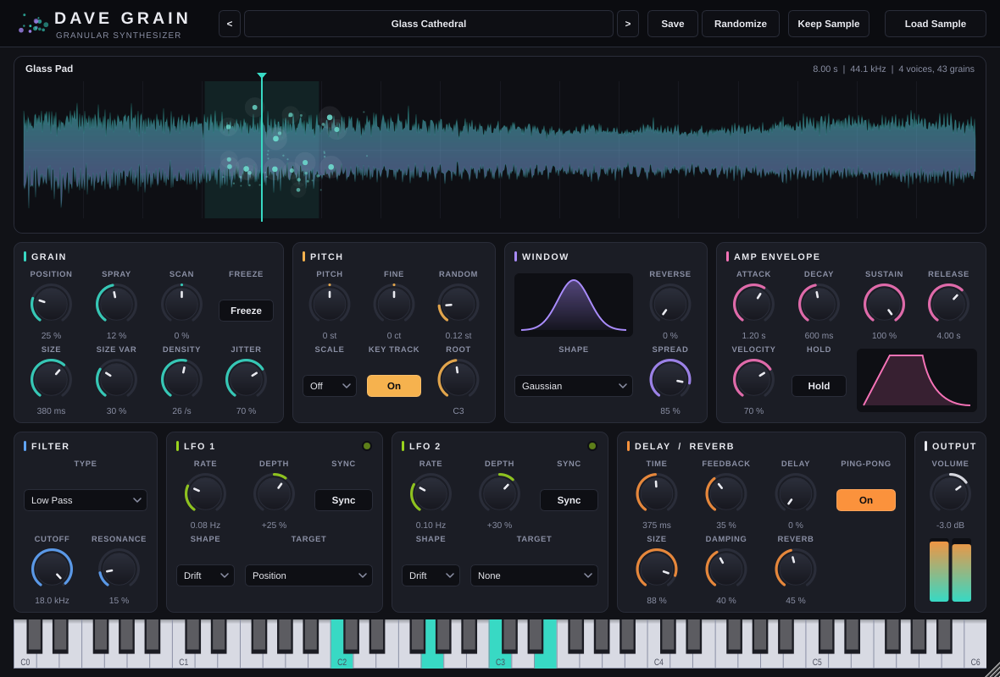

# Dave Grain — granular synthesizer

A polyphonic granular synthesizer plug-in (**VST3**, **Audio Unit** and **Standalone app**) for macOS,
built for **Ableton Live 11 Suite (11.3.x) on macOS Sonoma 14.x**, on both Apple Silicon and Intel Macs.



Drop in any WAV/AIFF/FLAC, play it from MIDI, and sculpt it into pads, textures, glitches and drones.
The design draws on Ableton Granulator, Mutable Instruments Clouds, Logic Alchemy, Padshop, Pigments,
Portal, Quanta and Borderlands. See [docs/RESEARCH.md](docs/RESEARCH.md) for how each granular
principle maps to a control.

## Features

- **Drag & drop samples** from Live's browser or Finder straight onto the plug-in (WAV, AIFF, FLAC, OGG, CAF), or use **Load Sample**. Three built-in sources (Glass Pad, Bell Cloud, Wind Texture) make sound before you load anything.
- **Live grain display**: every grain is drawn as a particle over the waveform. Click or drag the waveform to set the position, and scroll on it to set spray.
- **Grain engine**: Position, Spray, Scan (time-stretch, reverse, freeze), Size, Size Variation, Density, Jitter (synchronous ↔ asynchronous), six window shapes, Reverse probability, Stereo Spread.
- **Pitch**: ±24 semitones, fine tune, per-grain random pitch with **scale quantise** (semitones, octaves, fifths, major, minor, pentatonic), MIDI key tracking with selectable root, pitch bend.
- **Instrument**: 8-voice polyphony, ADSR, velocity, **Hold** (latch drones) and sustain pedal.
- **Modulation**: two LFOs (6 shapes, including smooth random Drift) that run free or **sync to Live's tempo**, each routable to Position, Spray, Size, Density, Pitch, Cutoff, Spread or Volume.
- **Sound shaping**: low-pass, band-pass and high-pass filter, ping-pong delay, reverb, and a soft-clipping output.
- **Presets**: 17 factory presets in categories, user preset save/load (`~/Music/Dave Grain/Presets`), **Randomize** for happy accidents, and **Keep Sample** to audition presets on your own sample.
- Every parameter is automatable in Live. Hover any control for a description; double-click a knob to reset it, and click its value to type a number.
- Resizable window (50–200 %). The size you choose is remembered with the Live set.

## Get the plug-in

### Option A: download the build from GitHub (no coding needed)
Every push builds the Mac version automatically using GitHub Actions (`.github/workflows/build-macos.yml`).
1. Open the repo on GitHub, go to **Actions**, select **Build macOS**, then open the latest successful run.
2. Download the **DaveGrain-macOS** artifact and unzip it.
3. Right-click **Install.command** and choose **Open**. It installs the VST3, AU and app for your user and removes the download quarantine.

To make a permanent download link, push a tag such as `v1.0.0`. The workflow then attaches the zip to a GitHub Release.

### Option B: build it on your Mac
Requirements: Xcode Command Line Tools (`xcode-select --install`) and CMake 3.22+ (`brew install cmake`).

```bash
git clone https://github.com/lorca7/dave-grain.git
cd dave-grain
cmake -B build -DCMAKE_BUILD_TYPE=Release -DCMAKE_OSX_ARCHITECTURES="arm64;x86_64"
cmake --build build --config Release --parallel
./build/DaveGrainTests_artefacts/Release/DaveGrainTests      # optional self-test
```
JUCE 8 is downloaded automatically. The results are in `build/DaveGrain_artefacts/Release/`:
`VST3/Dave Grain.vst3`, `AU/Dave Grain.component` and `Standalone/Dave Grain.app`. Copy them to
`~/Library/Audio/Plug-Ins/VST3/`, `~/Library/Audio/Plug-Ins/Components/` and `/Applications`.

## Using it in Ableton Live 11
1. **Live → Settings → Plug-Ins**: turn on **Use VST3 Plug-in System Folders** and/or **Use Audio Units**, then click **Rescan**.
2. In the browser, go to **Plug-Ins → VST3 (or Audio Units) → Dave Grain Audio → Dave Grain** and drag it onto a MIDI track.
3. Drag a sample from Live's browser (or Finder) onto the plug-in window and play some notes. All 46 parameters show up in Live's device panel for automation and MIDI mapping.

The **Standalone app** works without Live: it has its own audio/MIDI settings (Options menu) and an on-screen keyboard.

## Quick tour / recipes
| Try this | How |
|---|---|
| Time-stretch a loop | Preset **Time Stretch**: drop a loop, hold a note, then change **Scan** (100 % = original speed). |
| Freeze a moment | Click a spot on the waveform, turn on **Freeze** and set Size to 300–800 ms. |
| Endless drone | Turn on **Hold**, play a chord, and add LFO 1 → Position with the **Drift** shape. |
| Shimmering pad | Set **Random** pitch to 12 st with **Scale: Octaves** and Reverb Mix to 50 %. |
| Buzzy pitched tone | Set Size to about 10 ms, Density above 100 and **Jitter** to 0 %. Synchronous grains form a pitch. |
| Rhythmic glitch | Set an LFO to **Sync** at 1/16 with the **Random** shape, targeting Position. |
| Get unstuck | Click **Randomize**, then save anything you like with **Save**. |

## Presets & samples
- Presets are XML files (`.dgpreset`) in `~/Music/Dave Grain/Presets`. You can use sub-folders to make categories.
- Presets and Live sets store the sample's **file location**; the audio itself isn't embedded. If you move a sample, the plug-in says which file is missing; drop it in again. Use Live's *Collect All and Save* for your project audio, and keep plug-in samples in a stable folder.
- Factory presets never replace a sample you loaded yourself. User presets load their own sample unless **Keep Sample** is on.

## Project layout
```
Source/
  PluginProcessor.*   audio/MIDI processing, LFOs, state, sample loading
  PluginEditor.*      main window layout, drag & drop, load menu
  Parameters.*        all parameters, ranges, tooltips
  PresetManager.*     factory + user presets, randomize
  FactoryPresets.cpp  the 17 factory sounds
  dsp/GrainEngine.*   polyphonic grain scheduler / window tables / interpolation
  dsp/Effects.*       filter, ping-pong delay, reverb
  dsp/BuiltinSources  synthesised demo sources
  ui/                 look & feel, knobs, waveform+grain view, preset bar
tests/EngineTests.cpp headless render / preset / state tests (+ --bench, --snapshot)
```

## Verification
- `DaveGrainTests`: renders every factory preset, odd block sizes, extreme settings, voice stealing and 20 random patches (checks the output is finite and never above 0 dBFS). It also tests mono and stereo WAV loading at 44.1 and 96 kHz, missing files, host state round-trips and preset save/load. It passes under AddressSanitizer.
- [pluginval](https://github.com/Tracktion/pluginval) at strictness 10 passes on the VST3. The macOS CI also runs `auval` and pluginval on the AU.
- Worst-case CPU (8 voices × 96 overlapping 2-second grains, plus delay and reverb) is about 36 % of one core. Typical patches use a small fraction of that.

## Notes
- The build is ad-hoc signed, not notarised by Apple. That's why the installer removes the quarantine flag. To distribute it to others, sign it with a Developer ID and notarise it.
- MIDI note naming follows Live (middle C = C3 = note 60).
